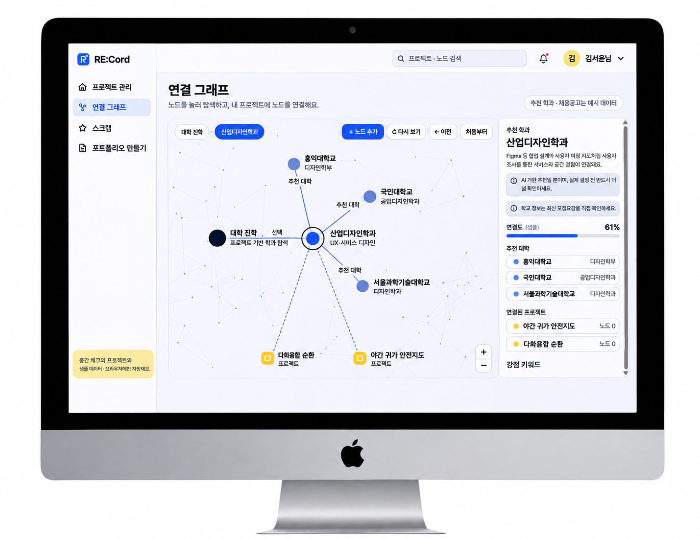

# 👾 RE:Cord

> **오늘의 경험을, 내일의 가능성으로.**  
> 대안학교 학생이 프로젝트 기록을 정리하고, 그 경험을 진로 탐색과 포트폴리오에 활용할 수 있도록 돕는 웹서비스입니다.

거꾸로캠퍼스 현장조사에서 학생들이 회의록, 회고, 사진, 발표자료를 꾸준히 남기고 있다는 점을 확인했습니다. 기록이 여러 곳에 흩어져 있어 진학이나 취업을 준비할 때 자신이 맡았던 역할과 문제 해결 과정, 이를 뒷받침하는 자료를 다시 찾아 정리해야 했습니다.

RE:Cord는 기존 기록을 프로젝트별로 모아 학생의 역할·과정·결과를 근거 자료와 연결합니다. 학생은 여러 프로젝트에서 반복된 관심사와 활동을 살펴보고, 관련 학과·직무를 탐색하거나 필요한 경험을 골라 포트폴리오를 구성할 수 있습니다.

## 👨‍💻 About our team

> 2026년 2학기 오픈소스소프트웨어프로젝트 4팀 RE.VERSE  
> *개발 기간: 2026.09 ~ 2026.12*

| 역할 | 이름 | 학과 |
| --- | --- | --- |
| 팀장 | 임여민 | 철학과 |
| 팀원 | 이영민 | 건축학과 |
| 팀원 | 정재윤 | 국제통상학과 |
| 팀원 | 조현서 | 통계학과 |

## 🕹️ 주요 기능



> ### 📁 내 프로젝트
>
> 회의록, 회고, 사진, 발표자료, 결과물을 프로젝트별로 모아 관리합니다. 활동에서 맡은 역할과 문제 해결 과정, 결과를 원본 기록과 함께 확인하고 설명이나 증빙이 부족한 부분을 보완할 수 있습니다.
>
> ### 🔗 나의 경험 관리
>
> 여러 프로젝트에서 공통으로 나타나는 주제, 활동 방법, 도구, 결과물을 연결 그래프로 살펴봅니다. 진학을 선택하면 관련 **학과 후보**, 취업을 선택하면 관련 **직무 후보**를 탐색합니다. 후보별로 어떤 프로젝트와 경험이 추천 근거가 되는지 확인할 수 있도록 설계했습니다.
>
> ### 📄 포트폴리오 만들기
>
> 목적에 맞는 프로젝트와 경험을 선택해 포트폴리오 초안을 구성합니다. 사용자는 초안을 직접 수정하고 미리보기에서 전체 구성과 내용을 확인할 수 있습니다.

## 설치 및 실행

현재 저장소에는 **중간 체크인용 HTML 프로토타입**이 있습니다.

1. GitHub 저장소에서 **Code → Download ZIP**을 선택합니다.
2. 다운로드한 ZIP 파일의 압축을 풉니다.
3. 압축을 푼 폴더에서 [`Src/prototype/RE-Cord-checkin-design-v1.html`](./Src/prototype/RE-Cord-checkin-design-v1.html)을 Chrome 또는 Edge로 엽니다.

연결 그래프에 필요한 라이브러리를 외부 CDN에서 불러오므로 **인터넷에 연결된 상태에서** 실행해 주세요.

Git으로 내려받으려면 아래 명령을 실행한 뒤 같은 HTML 파일을 엽니다.

```bash
git clone https://github.com/CSID-DGU/2026-2-OSSProj-RE.VERSE-04.git
cd 2026-2-OSSProj-RE.VERSE-04
```

데모는 샘플 데이터로 프로젝트 관리, 연결 그래프, 진학·취업 탐색, 포트폴리오 구성 흐름을 보여줍니다. 데모에서 변경한 내용은 사용 중인 브라우저에 저장됩니다.

## 구현 현황

| 구분 | 진행 내용 |
| --- | --- |
| **HTML 프로토타입** | 샘플 데이터로 프로젝트 관리, 연결 그래프, 학과·직무 탐색, 포트폴리오와 학생부 대체서식 미리보기 화면을 구성했습니다. |
| **진로 추천 실험** | 가상 학생의 프로젝트 5개를 대상으로 원문에서 경험 신호와 근거 문장을 추출하고, 공통 신호를 바탕으로 프로젝트 간 유사도를 계산했습니다. 같은 경험 데이터를 학과·직무별 기준과 비교해 후보를 정렬하는 과정도 별도로 실험했습니다. |
| **후속 개발** | 데이터베이스, 사용자 인증, 파일 저장, AI API를 연동할 예정입니다. 실제 대학·전형과 기업·채용공고의 데이터 연동 방식을 검토하고, 선택한 학교나 공고에 맞는 준비사항을 안내하는 기능을 설계합니다. |

### 기존 구현 및 변경 사항
 
| 단계 | 내용 |
| --- | --- |
| 초기 프로토타입 | HTML·CSS·JavaScript 기반 프로젝트 관리 화면 및 기본 서비스 흐름 구현 |
| 중간 체크인 (10.27) | 프로젝트·노트 추가 및 저장, 프로젝트 간 연결, 연결 그래프 시각화 기능 보완 |
| 중간발표 (11월) | 진학·취업 탐색 및 포트폴리오 구성 화면 보완, 가상 데이터 기반 프로젝트 관계·추천 계산 실험 |
| 후속 개발 예정 | DB·인증·파일 저장·AI API 연동, 통합 테스트 및 배포 |

**추천 실험 예시**  
가상 학생의 **야간 귀가 안전지도** 프로젝트에서 현장 조사와 지도 시각화 경험을 추출했습니다. 이 경험을 학과별 기준과 비교했을 때, 지리학과 후보를 제시하는 근거로 활용됐습니다.

## 프로젝트 관리 문서

| 문서 | 상태 |
| --- | --- |
| [수행계획서](./Doc/1_1_OSSProj_04_REVERSE_수행계획서.pdf) | PDF |
| [수행계획 발표자료](./Doc/1_2_OSSProj_04_REVERSE_수행계획발표자료.pdf) | PDF |
| [제안발표 회의록](./Doc/1_3_OSSProj_04_REVERSE_회의록.pdf) | PDF |
| [중간보고서](./Doc/2_1_OSSProj_04_REVERSE_중간보고서.pdf) | PDF |
| [중간발표자료](./Doc/2_2_OSSProj_04_REVERSE_중간발표자료.pdf) | PDF |
| [중간발표 회의록](./Doc/2_3_OSSProj_04_REVERSE_회의록.pdf) | PDF |

## 변경 이력 및 라이선스

**2026.09.29** — README와 제품 구성·배포·운영 계획 초안 작성.  
**2026.10.15** — 초기 HTML 프로토타입 제작.  
**2026.10.27** — 프로젝트·노트 연결과 연결 그래프 기능을 보완하여 중간 체크인용 MVP 구성.  
**2026.11.04** — 중간 체크인 데모 실행 방법과 구현 현황 반영.

**라이선스** — 팀 협의 후 확정하여 안내할 예정입니다.
